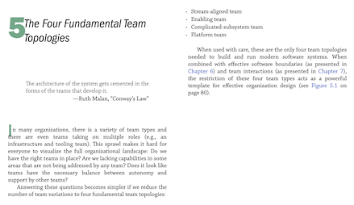
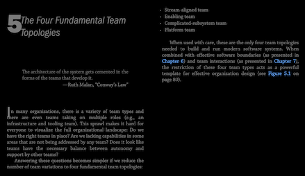
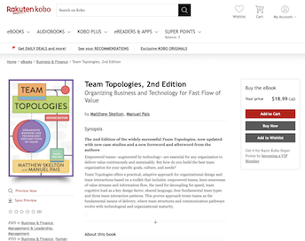
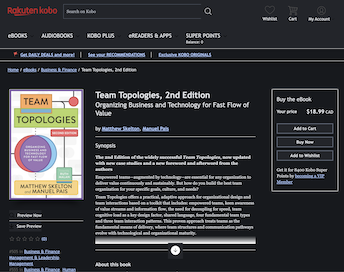

# Kobo Reader Extension

Chrome web extension for the Rakuten Kobo Reader website (Chrome, Brave, Edge).

- Syncs light and dark mode theme with the operating system for the reader and the Kobo website, including the "My Books" library page
- Reloads the reader when there are errors such as "User has no active session"







## Install
*The extension is not yet on a browser store; you load it as an unpacked extension.*

1. Download `kobo-reader-extension-vX.Y.Z.zip` from the
   [latest release](../../releases/latest).
2. Unzip it. You get a `kobo-reader-extension` folder containing `manifest.json`. Move it somewhere permanent: the browser reads it from there on every start.
3. Open the extensions page: `chrome://extensions`
4. Turn on **Developer mode**
5. Click **Load unpacked** and select the `kobo-reader-extension` folder (the one that directly contains `manifest.json`).
6. Reload any open Kobo tabs (`kobo.com`, `readnow.kobo.com`) to activate it.

To remove it, click **Remove** on the extensions page.

### Updating

1. Download the new release zip and replace the contents of your existing `kobo-reader-extension` folder with the new files.
2. On the extensions page click the reload icon on **Kobo Reader Extension**.
3. Reload your Kobo tabs. The browser may ask you to approve updated site access.

### Installing from source
Clone this repo and Load unpacked on the `extension/` folder.

## Development
Requires Node 18+; no dependencies.

```sh
npm test
```

This runs `tests/test.cjs` (session recovery) and `tests/theme-test.cjs` (appearance) against an instrumented DOM double. These are logic tests only: the real behaviour needs a signed-in Kobo session, so there is no automated live-browser test.

See [tests/VALIDATION.md](tests/VALIDATION.md) for what is covered and the manual checks still needed.

CI runs the tests on every push and pull request (`.github/workflows/test.yml`).

### Releasing

1. Bump `version` in `extension/manifest.json`.
2. Commit, then tag and push: `git tag v1.2.2 && git push origin v1.2.2`.

`.github/workflows/release.yml` runs the tests, checks that the tag matches the
manifest version, and publishes a GitHub release containing only
`kobo-reader-extension-vX.Y.Z.zip` (the `extension/` folder).

## AI Usage
- Implemented with OpenAI ChatGPT and GPT 6.1 Sol
- Updated with Anthropic Opus 5.5 and Sonnet 5.5
